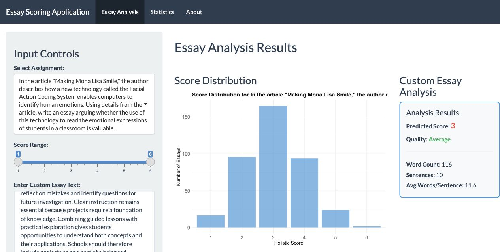

# Essay Scoring App

An interactive R Shiny app for exploring essay scores and analyzing custom writing. Built by Xiaoxi Chen for STAT 385 at UIUC, Fall 2025.

## Overview

- Explore score distributions by assignment and score range.
- Browse essay previews and summary statistics.
- Analyze custom text with word counts, sentence statistics, and a rule-based score from 1–6.
